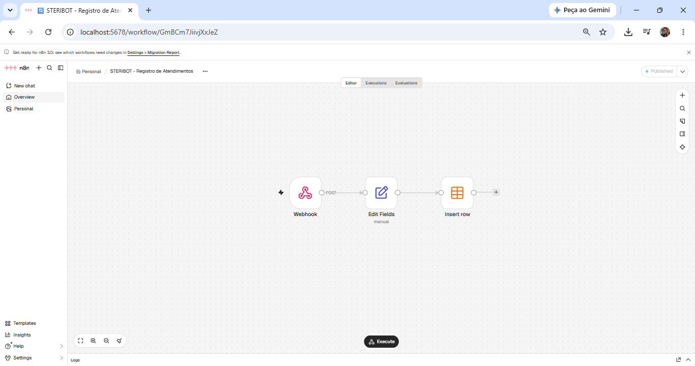
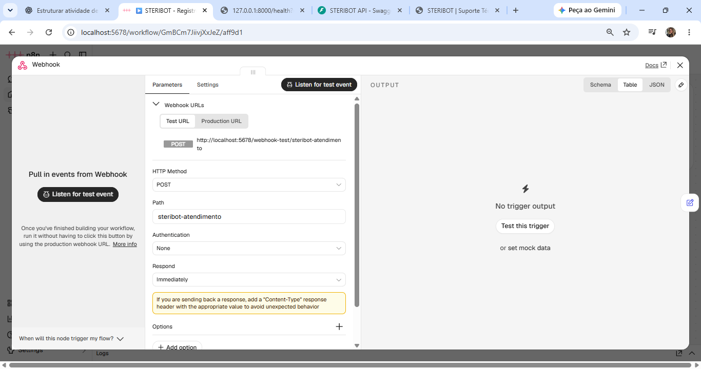
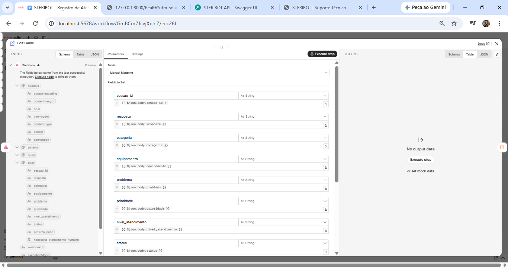
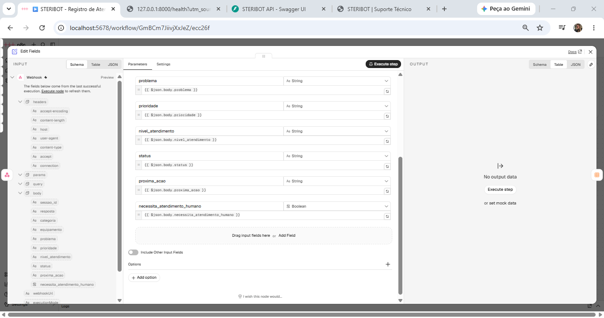
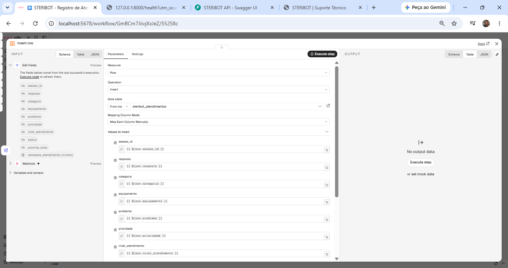
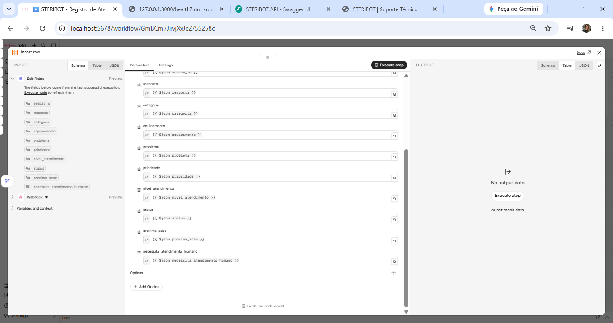
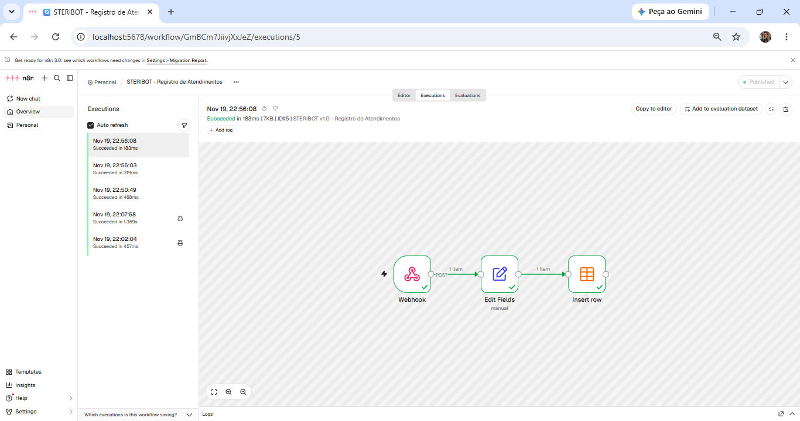
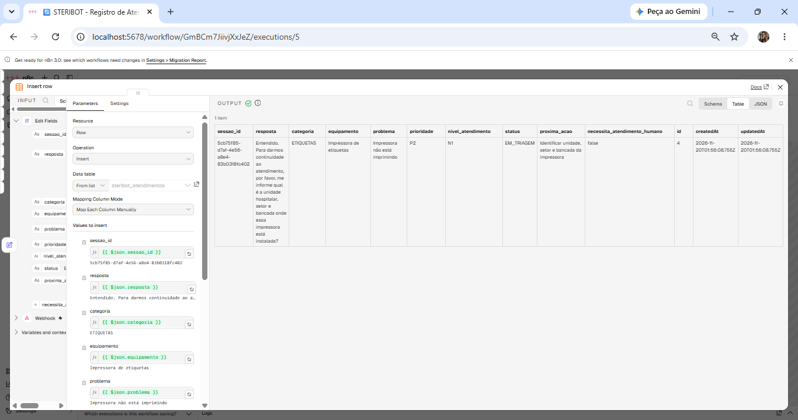

# STERIBOT — Assistente Inteligente de Suporte Técnico

**Projeto integrador | KODIE — Fundamentos de IA, Automação e Agentes**

## 1. Apresentação da ideia

O STERIBOT é um protótipo de assistente virtual desenvolvido para apoiar o atendimento e a organização de solicitações de suporte técnico relacionadas aos equipamentos utilizados em ambientes hospitalares.

A proposta surgiu da oportunidade de aplicar Inteligência Artificial à organização dos chamados técnicos, tornando o processo de identificação, classificação e encaminhamento das solicitações mais estruturado.

O projeto integra uma interface de atendimento, uma API em Python, um modelo de Inteligência Artificial e uma ferramenta de automação, demonstrando como essas tecnologias podem trabalhar em conjunto para resolver um problema operacional.

## 2. Problema escolhido

Em ambientes hospitalares, falhas em equipamentos e periféricos podem gerar solicitações de suporte que precisam ser identificadas, classificadas e encaminhadas adequadamente.

Mensagens pouco estruturadas podem dificultar a identificação do equipamento, a compreensão do problema, a definição da prioridade e o direcionamento para o nível de atendimento responsável.

O STERIBOT propõe utilizar IA para interpretar essas mensagens e organizar as informações necessárias ao atendimento.

O escopo inicial contempla três categorias:

- Impressoras de etiquetas;
- Impressoras de comprovantes;
- Impressoras de ciclos.

## 3. Solução proposta

O STERIBOT utiliza Inteligência Artificial para interpretar as mensagens dos usuários e produzir respostas contextualizadas, acompanhadas de informações estruturadas sobre o atendimento.

A IA participa do processo por meio de um prompt estruturado, que orienta a identificação e a classificação das solicitações.

As informações organizadas incluem:

- Resposta ao usuário;
- Categoria do problema;
- Equipamento;
- Descrição do problema;
- Prioridade;
- Nível de atendimento;
- Status do atendimento;
- Próxima ação recomendada;
- Necessidade de atendimento humano.

A resposta é validada e organizada em formato JSON, permitindo sua utilização pela API e pelo fluxo de automação.

O protótipo também mantém o histórico das conversas por sessão, possibilitando continuidade durante o atendimento.

## 4. Tecnologias utilizadas

| Tecnologia | Aplicação |
|---|---|
| Python | Linguagem principal do backend |
| FastAPI | Construção da API |
| Google Gemini | Processamento das mensagens por IA |
| OpenAI API | Provedor alternativo previsto na implementação |
| Pydantic | Validação e estruturação dos dados |
| n8n | Orquestração da automação |
| Data Tables | Armazenamento dos registros de atendimento |
| HTML, CSS e JavaScript | Desenvolvimento da interface |
| Docker | Execução do ambiente n8n |
| Git e GitHub | Versionamento e disponibilização do projeto |

## 5. Funcionamento do sistema

A arquitetura do STERIBOT é composta por quatro etapas principais.

### 5.1 Interface de atendimento

O usuário acessa a interface web e descreve o problema apresentado pelo equipamento.

A interface encaminha a mensagem para a API e apresenta a resposta gerada pelo assistente.

### 5.2 API e processamento por IA

A API, desenvolvida em FastAPI, recebe a solicitação e encaminha o conteúdo ao serviço de Inteligência Artificial.

O serviço utiliza um prompt estruturado e o histórico da sessão para interpretar a mensagem e gerar uma resposta em JSON.

A API valida o retorno, atualiza o histórico da conversa e prepara os dados para a automação.

### 5.3 Fluxo de automação no n8n

Após o processamento pela IA, a API envia os dados para um Webhook do n8n.

O fluxo é composto por três nós:

**Webhook:** recebe os dados enviados pela API por meio de uma requisição HTTP POST.

**Edit Fields:** organiza e mapeia os campos recebidos, padronizando as informações do atendimento.

**Insert Row:** registra os dados na Data Table `steribot_atendimentos`.

### 5.4 Armazenamento dos registros

Os atendimentos são registrados em uma tabela estruturada, permitindo consultar informações como categoria, equipamento, problema, prioridade, nível de atendimento e status.

O registro representa o histórico da interação processada pelo sistema, não necessariamente um chamado técnico formal ou uma ocorrência resolvida.

## 6. Como executar o projeto

### 6.1 Pré-requisitos

- Python instalado;
- Git instalado;
- Docker Desktop instalado e em execução;
- Chave de API do Google Gemini;
- Navegador web.

### 6.2 Clonar o repositório

git clone https://github.com/thaislarruda/STERIBOT_KODIE.git
cd STERIBOT_KODIE

Substitua o endereço pelo link definitivo do repositório.

### 6.3 Configurar as variáveis de ambiente

Crie uma cópia do arquivo `.env.example` com o nome `.env`.

Preencha a chave de acesso ao Gemini:

```env
GEMINI_API_KEY=sua_chave_de_api
GEMINI_MODEL=gemini-3.8-flash
AI_PROVIDER=gemini
N8N_WEBHOOK_URL=http://localhost:5678/webhook/steribot-atendimento
```

Não compartilhe o arquivo `.env` nem publique chaves de API no GitHub.

### 6.4 Instalar as dependências

Na raiz do projeto, crie e ative o ambiente virtual:

```powershell
python -m venv .venv
.\.venv\Scripts\Activate.ps1
```

Instale as dependências:

```powershell
pip install -r backend/requirements.txt
```

### 6.5 Iniciar o backend

Na raiz do projeto, execute:

```powershell
python -m uvicorn backend.app.main:app --reload
```

A API ficará disponível em:

`http://127.0.0.1:8000`

A documentação interativa pode ser acessada em:

`http://127.0.0.1:8000/docs`

### 6.6 Iniciar o frontend

Abra outro terminal:

```powershell
cd frontend
python -m http.server 5500
```

A interface estará disponível em:

`http://127.0.0.1:5500`

### 6.7 Iniciar o n8n

Com o Docker Desktop em execução, abra outro terminal:

```powershell
cd n8n
docker compose up -d
```

Acesse:

`http://localhost:5678`

Importe o arquivo `n8n/steribot-workflow.json` caso esteja configurando uma nova instalação.

Configure a Data Table `steribot_atendimentos` com os campos utilizados no fluxo e ajuste o vínculo do nó de registro para a tabela da nova instalação.

Publique o workflow e configure a URL de produção do Webhook na variável `N8N_WEBHOOK_URL` do arquivo `.env`.

## 7. Evidências e documentação

As capturas de tela demonstram a implementação e o funcionamento da automação.

### 7.1 Estrutura do fluxo



### 7.2 Configuração do Webhook



### 7.3 Configuração do Edit Fields

**Parte 1 – Campos iniciais**



**Parte 2 – Campos finais**



### 7.4 Configuração do Data Table

**Parte 1 – Configuração e primeiros campos**



**Parte 2 – Mapeamento dos campos restantes**



### 7.5 Execução bem-sucedida



### 7.6 Resultado da automação



O fluxo exportado está disponível em `n8n/steribot-workflow.json`.

## 8. Considerações e limitações

O STERIBOT é um protótipo acadêmico e demonstrativo, desenvolvido no contexto do desafio técnico da KODIE.

A implementação atual demonstra a integração entre interface, API, Inteligência Artificial e automação.

O histórico de conversas do backend é mantido em memória durante a execução da aplicação. O registro dos atendimentos enviados ao n8n é armazenado na Data Table.


Sua utilização em ambiente produtivo depende de validação técnica, autorização institucional, avaliação de segurança da informação e adequação às políticas de privacidade e proteção de dados.

## 9. Autoria

**STERIBOT — Assistente Inteligente de Suporte Técnico**

Projeto desenvolvido por Thais Arruda no contexto do projeto integrador da KODIE, aplicando conhecimentos de Inteligência Artificial, engenharia de prompts, desenvolvimento de APIs e automação de processos.
